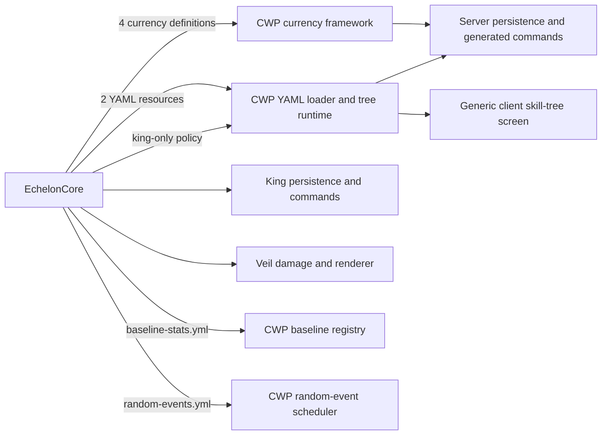

# EchelonCore

EchelonCore contains the concrete gameplay systems for the Echelon server. It registers Echelon's currencies, skill trees, baseline stat profile, and random-event configuration with [Crazy World Progression](https://github.com/LeonHosch/CrazyWorldProgression) (CWP), then adds the king, Powerful Soul, and veil rules that are specific to Echelon.

## Requirements

| Component | Version |
| --- | --- |
| Minecraft | 26.2 |
| Java | 25 or newer |
| Fabric Loader | 0.19.3 or newer |
| Fabric API | 0.158.0+26.2 |
| Crazy World Progression | 1.0.0 or newer |

EchelonCore and CWP must both be installed on the client and server. CWP owns the skill-tree screen and networking; EchelonCore owns the content displayed in it and Echelon's client-side veil effects.

## Responsibilities



CWP reads EchelonCore's YAML files directly at server startup. EchelonCore registers the tree directory and baseline profile and supplies the king-only purchase policy; it does not parse or translate those definitions itself.

## Gameplay systems

### Currencies

EchelonCore registers four currencies. CWP supplies their storage, commands, balance screen data, and skill-tree cost handling.

| Currency | Abbreviation | Scope | Commands |
| --- | --- | --- | --- |
| Kingdom Points | KP | One shared global balance | `/kp`, `/kingdompoints` |
| Echelon Points | EP | Per player | `/ep`, `/echelonpoints` |
| Fakhrul Currency | FC | Per player | `/fc`, `/fakhrul` |
| Powerful Souls | PS | Per player | `/ps`, `/powerfulsouls` |

Balances are non-negative whole numbers. Earning rules are separate from the wallet framework: EchelonCore currently exposes Powerful Soul claim logic, while other gameplay listeners can award any currency through CWP's `CurrencyService`.

### Skill trees

The bundled definitions live in [`src/main/resources/skilltrees`](src/main/resources/skilltrees):

| Tree | Scope | Content | Special rule |
| --- | --- | --- | --- |
| [`kingdom-progression.yml`](src/main/resources/skilltrees/kingdom-progression.yml) | Global | 8 branching kingdom upgrades paid with KP and FC | Only the appointed king may purchase nodes |
| [`a-new-beginning.yml`](src/main/resources/skilltrees/a-new-beginning.yml) | Personal | 9 personal upgrades paid with EP | Each player owns their unlocks |

Tree effects combine combat, movement, gathering, reward, interaction-range, and Echelon-specific Veil Level progression. Every node declares a mandatory stable `id`, and every `previous` value references one of those IDs rather than a display name. CWP validates all costs, prerequisites, branch limits, identifiers, cycles, and stat expressions before making the trees available.

Each side of the menu begins with CWP's stat sheet, followed by Echelon's YAML trees. The optional root-level `priority` field orders trees on the same side from lowest to highest; equal priorities fall back to the YAML filename alphabetically.

### Advancements

EchelonCore filters the complete server advancement definition map whenever datapacks load or `/reload` runs. Vanilla, other-mod, and datapack advancements are removed; only definitions in the `echelon-core` namespace remain. The bundled definitions live in [`data/echelon-core/advancement`](src/main/resources/data/echelon-core/advancement).

| Tab | Milestones |
| --- | --- |
| Mining | First stone; 1,000 and 10,000 stone; first coal, iron, gold, diamond, and ancient debris |
| Woodworking | First log; 100, 1,000, and 10,000 logs; crafting table, wooden axe, chest, and bookshelf |
| Mysteries of the World | First entry into the Veil, outer Veil, Powerful Soul, first Veil Level, kingship, Nether, and End |

The mystery root is named **Beyond the Shroud** and is awarded when a player actually crosses the inner Veil radius for the first time. Mining and woodworking use Minecraft's persistent block-mined and item-crafted statistics, so established players can receive already-earned milestones after joining. [`EchelonAdvancementManager.java`](src/main/java/ekuzo/echeloncore/advancement/EchelonAdvancementManager.java) performs these authoritative checks once per second.

Existing non-Echelon advancement progress files are left untouched; their definitions are simply unavailable while EchelonCore is installed. Because vanilla recipe-book unlocks are advancement-driven, recipes are no longer discovered automatically in the recipe book. The recipes themselves remain craftable when players know their layouts.

### King system

One player UUID can be persisted as the current king. The king is allowed to purchase nodes from `echelon-core:kingdom-progression`; other players can view the tree but receive a denial reason when trying to buy from it.

Changing or clearing the king does not alter kingdom unlocks or balances.

### Powerful Soul claims

`PowerfulSoulService.claim` combines CWP's generic claim ledger with the Echelon Powerful Souls wallet. A successful unique claim awards exactly one PS. Duplicate claim IDs and configured lifetime limits are rejected.

The service is an integration point for gameplay such as boss or event completion; it does not decide by itself which Minecraft events count as a claim.

```java
ClaimLedgerService.ClaimResult result = PowerfulSoulService.claim(
        server,
        player.getUUID(),
        EchelonCore.id("boss/ancient_guardian"),
        10
);
```

### Veil

Veil Level is a global numeric progression value registered by EchelonCore with CWP. It starts at `0`, and `addVeilLevel` accepts only `addVeilLevel(1)`, ensuring every relevant node increments it by exactly one. The current kingdom tree can reach Veil Level 4. Other Echelon systems can read it with `VeilManager.getVeilLevel(server)`.

Veil Level does not change the original world-edge veil range or damage. Those mechanics retain the following hardcoded behavior:

The veil is centered on the overworld spawn and uses horizontal distance.

| Distance from spawn | Server effect |
| --- | --- |
| 0-1000 blocks | Safe zone |
| More than 1000 and up to 1200 blocks | 2 magic damage every 5 seconds |
| More than 1200 blocks | 5 magic damage every second |

The client renderer visualizes the two cylindrical boundaries and adds the associated fog, sky, HUD, and sound effects.

#### Hand-placed Veil anomalies

Game masters can place persistent spherical, cylindrical, cubic, and pyramidal anomaly boundaries anywhere and in any dimension. An anomaly begins with a solid, opaque state at Veil Level 0. Additional state thresholds independently control collision, visibility, and block access:

- Boundary mode: `keep_out` (the default) permits leaving but rejects entry, while `keep_in` permits entry but rejects escape after a player has entered.
- Collision: `solid` or `passable`
- Visibility: `opaque`, `translucent`, or `hidden`
- Block interaction: `protected`, `allowed`, or backward-compatible `automatic` (protected while solid and allowed while passable)
- The highest configured `minimum_level` not exceeding the current Veil Level is active.
- A nonzero threshold can be replaced or removed later.

For example, this creates a 40-block-radius sphere that becomes passable at level 3, remains impossible to see or build through, and disappears and permits building at level 5:

```text
/veil anomaly create forgotten_temple sphere 40
/veil anomaly state set forgotten_temple 3 passable opaque protected
/veil anomaly state set forgotten_temple 5 passable hidden allowed
```

Solid anomalies no longer create physical collision. Clients receive authoritative definitions and cache and render the selected sphere, cylinder, pyramid, or cube mesh. The server checks players against that actual shape after movement and uses chorus-style random teleports to enforce the selected one-way boundary. This avoids invisible ledges, mid-air sticking, and pose-based movement problems entirely.

Use `/veil anomaly mode <id> keep_in` for a one-way containment anomaly. The server begins tracking a player when their complete standing-size body enters it, remembers the latest valid inside position, and chorus-teleports them back inside if they cross the boundary in the same dimension. Changing dimension deliberately releases containment, providing an intended escape route. Players outside are not pulled in, and remembered memberships are intentionally session-only: after a server restart, players already standing inside are registered again while players outside remain outside. A `keep_in` anomaly does not apply the interior blackout because contained players need to see and play inside it; its opaque rendered surface still blocks the view through the boundary.

A dimension may contain either multiple `keep_out` anomalies or exactly one `keep_in` anomaly, never both. Create, move, and mode commands reject layouts that violate this rule. If conflicting old saved data is loaded, its `keep_in` definitions safely behave as `keep_out` until an administrator removes the conflict.

Rejection uses a fixed standing-size player body, so sneaking, swimming, and other pose changes cannot bypass it. EchelonCore tries up to 24 random destinations within a six-block horizontal radius and four vertical blocks, predicts vanilla's eventual ground landing, and rejects every candidate that would leave the player inside any solid anomaly. Successful rejection uses the vanilla chorus teleport particles, sound, and game event. If a large anomaly covers the entire local search area, a second search moves horizontally just beyond its footprint before looking for ground; it never chooses the unsupported upper face. A recent nearby safe position and a deterministic horizontal outside point remain as final fallbacks for logins, external teleports, overlapping anomalies, or terrain with no valid nearby landing.

Players cannot break, use, or normally place blocks inside or within one block of an anomaly whose resolved block-interaction state is `protected`. This interaction guard is predicted by the client to avoid mining cracks and ghost placements, then independently enforced by the server. Block access is independent of movement and visibility, so a `passable opaque protected` state permits entry without exposing or permitting changes to the build. Omitting the block-interaction argument selects `automatic`, preserving the former solid/protected and passable/allowed behavior.

The client blacks out the entire screen while the actual rendered camera approaches or enters a solid `keep_out` anomaly, preventing transient entry, third-person camera movement, or detached camera adjustments from revealing the protected build even when the player's body remains outside. A 0.75-block safety margin starts blackout before the camera's near viewing plane can clip through the surface. `keep_in` anomalies deliberately do not black out their interior. Entering an anomaly whose current state is `passable opaque` does not black out the screen; it applies the same fog, sky, ambience, and transition treatment as the original inner world Veil. `passable translucent` has no interior vision penalty.

Opaque anomaly surfaces use an unblended, depth-writing render pipeline. Terrain, entities, water, clouds, weather, and particles behind the surface are therefore fully occluded; translucent anomaly states deliberately keep the blended renderer. A `solid opaque` surface retains the dark purple color, while `passable opaque` becomes light pink to communicate that players may cross it even though they still cannot see through it.

Server boundary enforcement and interaction protection use separate 64-block spatial indexes. The first contains only anomalies currently resolved as solid; the second contains only anomalies whose resolved state protects blocks, including passable anomalies when explicitly requested. Unrelated definitions are absent rather than checked and skipped. When CWP applies a changed global Veil Level, EchelonCore immediately rebuilds both indexes and synchronizes clients; the once-per-second level check is only a fallback.

Geometry uses the command source as its center. Cylinders are vertical. Pyramids have a centered rectangular base at the bottom and an apex at the top. Definitions and level states are stored in the world and survive restarts.

### Baseline stat profile

Echelon's starting adjustments live in [`baseline-stats.yml`](src/main/resources/baseline-stats.yml). They use the same `function(number)` expressions as skill-tree nodes. CWP parses the file through its skill-stat registry, applies stable transient modifiers whenever a player joins, respawns, or refreshes progression, and uses the same declarations for the stat-sheet Start column:

| Attribute | Modifier |
| --- | --- |
| Block-breaking speed | +100% |
| Movement speed | +40% |
| Maximum health | -4 health points (2 hearts) |

These are Echelon defaults, separate from bonuses granted by unlocked CWP skill nodes. Negative percentage expressions work normally; for example, `addMovementSpeed(-20)` reduces starting movement speed by 20%.

### Random events

Echelon's event schedules live in [`random-events.yml`](src/main/resources/random-events.yml), while CWP loads the definitions, performs random rolls, and persists active instances and their metadata. Concrete effects remain Echelon systems: temporary stats, sky rendering, spawned structures, teleportation, MobForge waves, rewards, and cleanup are not implemented by the scheduler.

The initial configuration contains no event definitions yet. It does contain the recurring core-RP protection window:

| Time zone | Protected slot | Effect |
| --- | --- | --- |
| Europe/Berlin | Every Friday from 19:00 until Saturday 00:00 | CWP performs no automatic event starts |

Events already active at 19:00 continue until their configured duration ends. Change the blackout's `end` value if the protected RP slot should extend beyond midnight.

Future Blood Moon or Rift definitions belong in this Echelon-owned YAML file. Their implementation classes can register CWP lifecycle handlers and query `RandomEventService` without moving Echelon-specific behavior into the framework.

### Portal instances

Portal template authoring and temporary-dimension lifecycle now live directly in CWP rather than EchelonCore. Game masters can enter the workshop from `/cwp admin`, select a draft with left- and right-click, set an explicit in-selection pocket spawn, and save or clear that selected draft. A separate Portals page places and edits two-dimensional portals without coordinate commands; shape and plane use constrained dropdowns, while the page also controls linked templates, dimensions, real-time lifetimes, and calendar or repeating timer gates. CWP reconstructs templates in reusable empty dimensions, evacuates players when time expires, and clears each slot before reuse.

EchelonCore currently ships no captured portal template or placed portal. Future Echelon rifts, dungeons, and story dimensions can use CWP's commands and `PortalRegistry` lifecycle listener without introducing a second template format here. See CWP's README and `/cwp portals` for the complete authoring workflow.

## Installation

Install the following in the `mods` directory on every client and the server:

1. Fabric API
2. `crazy-world-progression-1.0.0.jar`
3. `echelon-core-1.0.0.jar`

Keep the mod versions identical on both sides. EchelonCore will not load without CWP.

## Commands

Currency commands are generated by CWP from the definitions registered here.

| Command | Permission | Description |
| --- | --- | --- |
| `/balance` | Player | Show all four balances |
| `/balance <targets>` | Game master | Inspect selected profiles |
| `/ep`, `/fc`, `/ps` | Player | Show the executing player's balance |
| `/kp` | Player | Show the shared Kingdom Points balance |
| `/ep\|fc\|ps give <amount> <targets>` | Game master | Credit selected player wallets |
| `/ep\|fc\|ps take <amount> <targets>` | Game master | Debit selected player wallets |
| `/ep\|fc\|ps set <amount> <targets>` | Game master | Set selected player wallets |
| `/kp give\|take\|set <amount>` | Game master | Change the shared KP balance |
| `/skill` | Player | Open the CWP skill-tree screen |
| `/king` | Player | Show the current king |
| `/king set <player>` | Game master | Appoint exactly one player as king |
| `/king clear` | Game master | Clear the current king |
| `/veil` | Player | Show the current Veil Level and anomaly/index counts |
| `/veil anomaly list` | Game master | List placed anomalies and their currently resolved states |
| `/veil anomaly info <id>` | Game master | Show one anomaly's geometry and complete level-state sequence |
| `/veil anomaly create <id> sphere <radius>` | Game master | Create a sphere centered at the command position |
| `/veil anomaly create <id> cylinder <radius> <height>` | Game master | Create a vertical cylinder |
| `/veil anomaly create <id> cube <width> <height> <depth>` | Game master | Create an axis-aligned box |
| `/veil anomaly create <id> pyramid <width> <height> <depth>` | Game master | Create an upright rectangular pyramid |
| `/veil anomaly move <id> here` | Game master | Move an anomaly to the command position and dimension |
| `/veil anomaly mode <id> <keep_out\|keep_in>` | Game master | Select whether the solid boundary rejects entry or escape |
| `/veil anomaly state set <id> <level> <collision> <visibility> [block_interaction]` | Game master | Insert or replace a level threshold; block interaction defaults to `automatic` |
| `/veil anomaly state remove <id> <level>` | Game master | Remove a nonzero level threshold |
| `/veil anomaly remove <id>` | Game master | Permanently delete an anomaly |

The long currency names shown in the currency table are aliases with the same subcommands.

## Development setup

The Gradle build expects CWP and EchelonCore to be sibling directories with these exact names:

```text
githubbb/
├── CrazyWorldProgression/
└── EchelonCore/
```

Clone both repositories into that layout, install a Java 25 JDK, and run commands from `EchelonCore`.

### Build both mods

```powershell
.\gradlew.bat clean build
```

Because CWP is included as a Gradle subproject, this compiles and packages both repositories. The usable mod JARs are:

```text
../CrazyWorldProgression/build/libs/crazy-world-progression-1.0.0.jar
build/libs/echelon-core-1.0.0.jar
```

Ignore `-sources.jar` when installing the mods.

### Run an integrated client

```powershell
.\gradlew.bat :runClient
```

The leading `:` selects EchelonCore's root `runClient` task. Without it, Gradle may find matching run tasks in both projects.

Create a world with cheats enabled, then use this quick smoke test:

```text
/ep give 500 @s
/fc give 100 @s
/ps give 20 @s
/kp give 200
/king set @s
/skill
```

Verify that both tabs open, personal purchases spend the correct player currencies, the kingdom tree only accepts purchases from the king, global unlocks affect everyone, and balances survive leaving and reopening the world.

For a two-player test, use CWP's second configured client from the same multi-project build:

```powershell
.\gradlew.bat :crazy-world-progression:runClient2
```

### Run a dedicated server

```powershell
.\gradlew.bat :runServer
```

The first run creates `run/eula.txt` and stops. Set `eula=true`, rerun the command, and connect with a development client. Do not commit the generated `run` directory.

## Customization map

| Change | Location |
| --- | --- |
| Add or edit an Echelon currency | [`EchelonCore.java`](src/main/java/ekuzo/echeloncore/EchelonCore.java) and `src/main/resources/assets/echelon-core/currencies` |
| Edit tree nodes, costs, text, or stats | [`src/main/resources/skilltrees`](src/main/resources/skilltrees) |
| Change the king-only purchase rule | [`EchelonCore.java`](src/main/java/ekuzo/echeloncore/EchelonCore.java) |
| Change king persistence or commands | [`src/main/java/ekuzo/echeloncore/king`](src/main/java/ekuzo/echeloncore/king) and [`KingCommands.java`](src/main/java/ekuzo/echeloncore/command/KingCommands.java) |
| Integrate Powerful Soul rewards | [`PowerfulSoulService.java`](src/main/java/ekuzo/echeloncore/progression/PowerfulSoulService.java) |
| Change veil radii or damage | [`VeilManager.java`](src/main/java/ekuzo/echeloncore/veil/VeilManager.java) |
| Change veil visuals and sounds | [`VeilRenderer.java`](src/client/java/ekuzo/echeloncore/veil/VeilRenderer.java) |
| Change anomaly geometry, persistence, collision, or synchronization | [`src/main/java/ekuzo/echeloncore/veil/anomaly`](src/main/java/ekuzo/echeloncore/veil/anomaly) |
| Change anomaly mesh rendering or client prediction | [`src/client/java/ekuzo/echeloncore/veil/anomaly`](src/client/java/ekuzo/echeloncore/veil/anomaly) |
| Change baseline attributes | [`baseline-stats.yml`](src/main/resources/baseline-stats.yml) |
| Configure event rolls, durations, availability, or RP blackouts | [`random-events.yml`](src/main/resources/random-events.yml) |
| Implement an event's gameplay and cleanup | EchelonCore event handler registered through CWP's `RandomEventRegistry` |
| Change the no-advancements rule | [`ServerAdvancementManagerMixin.java`](src/main/java/ekuzo/echeloncore/mixin/ServerAdvancementManagerMixin.java) |
| Change Echelon's CWP admin pages and actions | [`EchelonAdminModule.java`](src/main/java/ekuzo/echeloncore/admin/EchelonAdminModule.java) |

Adding a currency only requires a `CurrencyDefinition` registration and its texture. CWP's generic storage, snapshots, GUI badges, and commands automatically adapt to the expanded registry. Refer to CWP's README for the complete currency and YAML extension APIs.

Tree resources are loaded when the server starts and can also be reloaded from `/cwp admin` or `/cwp reload` while testing.

## Administration panel

Run `/cwp admin` as a game master. CWP renders the shared dashboard and its native framework module; EchelonCore registers a second `EchelonCore` button through CWP's public `AdminPanelRegistry` API. Its pages cover the current king, appointing online rulers, Veil Level diagnostics, anomaly state and removal, advancement policy, and online Echelon Point totals. The CWP Currency page lists EchelonCore's four currency definitions and applies Give/Take/Set operations through a shared player-autocomplete and amount form rather than rendering every player's wallet. Destructive actions such as clearing the crown, removing an anomaly, setting a wallet, or clearing a workshop draft require confirmation where appropriate.

## Persistence and migration

Currency balances, claims, tree unlocks, the king UUID, and Veil anomaly definitions are stored in the world rather than a separate database. CWP migrates legacy EP, FC, PS, KP, claim, and unlock fields, while EchelonCore adopts the legacy elected-king value into its own king data.

Back up an existing world before testing migrations or changing currency IDs, tree filenames, or skill IDs. Those identifiers are stable persistence keys.

## Current limitations

- The king is appointed through an operator command; there is no automated election flow yet.
- `PowerfulSoulService` is ready for event integrations, but the concrete boss/event listeners still need to call it.
- Other currency earning rules belong to Echelon gameplay code and are not generated automatically.
- Blood Moon, Rift, and other concrete random-event gameplay are not implemented yet; only their scheduler and configuration foundation exist.
- Skill-tree YAML is bundled in the mod JAR and requires a restart to reload.

## License

EchelonCore is licensed under the [MIT License](LICENSE). Crazy World Progression remains a separate AGPL-3.0-only dependency under its own license.
